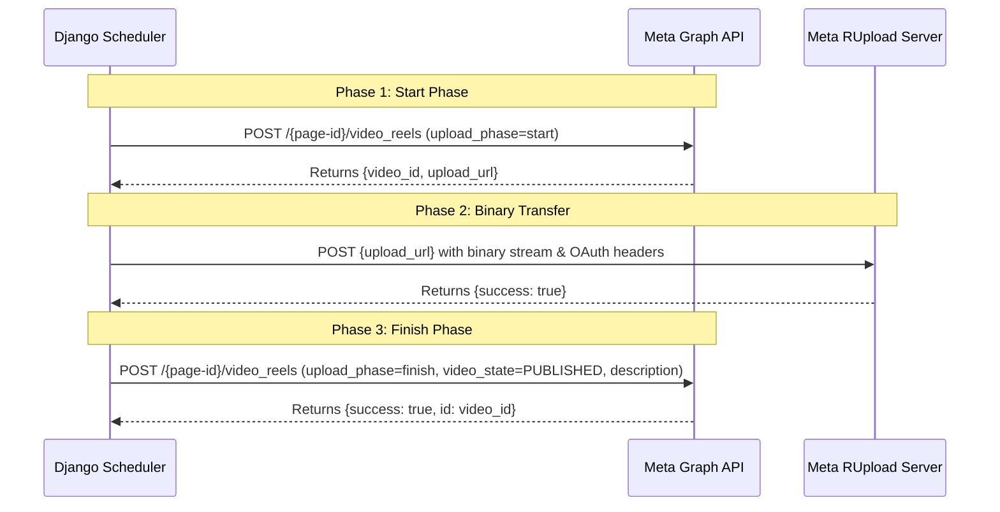

# Meta Graph API & Facebook Publishing Engine Setup Guide
**Project:** Automated Facebook Content Generation & Scheduling Engine  
**Client / Owner:** Rev. Fr. Ejiogu Chukwuemeka  
**Lead Systems Engineer:** Engr. Christian Kelechi Eze  
**Architecture:** Zero-Cost AI Endpoints + Contabo VPS Ubuntu LTS / Docker  

---

## 1. Overview

This document provides a comprehensive, production-ready walkthrough for configuring the **Meta Graph API** to enable programmatic publishing of:
1. **Text Feed Posts** (`POST /{page-id}/feed`)
2. **Branded Graphic Quote Cards** (`POST /{page-id}/photos`)
3. **9:16 Vertical Video Reels** (Meta 3-Step Reels Protocol via `POST /{page-id}/video_reels` and `rupload.facebook.com`)

The application supports both live Meta publishing and a graceful mock simulation mode for testing when tokens are not yet provided.

---

## 2. Prerequisites

1. **Personal Facebook Account** that is designated as an **Admin** of Rev. Fr. Ejiogu Chukwuemeka’s official Facebook Page.
2. A **Meta for Developers Account** (free registration at [developers.facebook.com](https://developers.facebook.com)).
3. The numeric **Facebook Page ID** for the target Page.

---

## 3. Step-by-Step Meta Developer App Creation

### Step 1: Create the Meta App
1. Navigate to the [Meta App Dashboard](https://developers.facebook.com/apps).
2. Click **Create App**.
3. When asked *"What do you want your app to do?"*, select **Other** and click **Next**.
4. Select **Business** as the App Type and click **Next**.
5. Fill in the app details:
   - **App Display Name:** `Fr Ejiogu Content Scheduler` (or similar)
   - **App Contact Email:** Enter your primary contact email.
   - **Business Account:** Select your Meta Business Portfolio (or leave unassigned).
6. Click **Create App** and complete the security verification.

---

### Step 2: Add Necessary Graph API Permissions

In the Meta App Dashboard:
1. In the left navigation, click **App settings** &rarr; **Basic**.
2. Note your **App ID** and **App Secret** (click *Show* to reveal). You will need these in your `.env` file.
3. Under **Add products to your app**, locate and configure **Facebook Login for Business**.
4. To post to the Facebook Page and publish Reels, your app and tokens require the following **4 Essential Permissions**:

| Permission | Description | Why It Is Mandatory |
| :--- | :--- | :--- |
| `pages_show_list` | Access list of managed pages | Allows discovering your Page ID and retrieving Page tokens |
| `pages_read_engagement` | Read page profile and engagement | Allows verifying page identity and post performance |
| `pages_manage_posts` | Create and publish feed and photo posts | Authorizes publishing daily reflection text and quote cards |
| `publish_video` | Upload and publish video media | **Mandatory** for publishing 9:16 vertical video reels |

---

## 4. Generating a Never-Expiring Long-Lived Page Access Token

Standard user tokens generated in Meta’s UI expire after **1 to 2 hours**. To keep the autonomous scheduler running 24/7 without manual intervention, you must generate a **Never-Expiring Page Access Token**.

Follow this 3-tier token exchange workflow:

### Tier 1: Generate Short-Lived User Token
1. Open the [Meta Graph API Explorer](https://developers.facebook.com/tools/explorer).
2. In the top right:
   - **Meta App:** Select your newly created app (`Fr Ejiogu Content Scheduler`).
   - **User or Page:** Select **User Token**.
3. Under **Permissions**, click **Add a Permission** and select:
   - `pages_show_list`
   - `pages_read_engagement`
   - `pages_manage_posts`
   - `publish_video`
4. Click **Generate Access Token**.
5. Log into Facebook and approve the permissions for Rev. Fr. Ejiogu Chukwuemeka's Page.
6. Copy the generated short-lived token string (`EAA...`).

---

### Tier 2: Exchange for a 60-Day Long-Lived User Token
Execute an HTTP GET request to the OAuth access token exchange endpoint (replace the bracketed placeholders with your actual values):

```bash
curl -X GET "https://graph.facebook.com/v19.0/oauth/access_token?\
grant_type=fb_exchange_token&\
client_id=YOUR_META_APP_ID&\
client_secret=YOUR_META_APP_SECRET&\
fb_exchange_token=YOUR_SHORT_LIVED_USER_TOKEN"
```

**Meta Response:**
```json
{
  "access_token": "EAA...LONG_LIVED_USER_TOKEN...",
  "token_type": "bearer",
  "expires_in": 5184000
}
```
*Note: `5184000` seconds equals 60 days.*

---

### Tier 3: Exchange for a Never-Expiring Page Access Token
Using the 60-day User Token from Tier 2, query the accounts endpoint for your Page:

```bash
curl -X GET "https://graph.facebook.com/v19.0/YOUR_PAGE_ID?fields=access_token,name&\
access_token=YOUR_LONG_LIVED_USER_TOKEN"
```
Or query all pages associated with the account:
```bash
curl -X GET "https://graph.facebook.com/v19.0/me/accounts?\
access_token=YOUR_LONG_LIVED_USER_TOKEN"
```

**Meta Response:**
```json
{
  "access_token": "EAA...PERMANENT_PAGE_ACCESS_TOKEN...",
  "name": "Rev. Fr. Ejiogu Chukwuemeka",
  "id": "104829104812345"
}
```

> [!IMPORTANT]
> **Page Access Tokens derived from a 60-day Long-Lived User Token NEVER EXPIRE.**  
> They will remain valid indefinitely unless the Page Admin changes their Facebook password or revokes the app permissions.

---

## 5. Locating Your Numeric Facebook Page ID

1. Open Facebook in your browser and switch to Rev. Fr. Ejiogu Chukwuemeka's Page.
2. Go to the **About** section &rarr; **Page Transparency** (or visit `https://www.facebook.com/YOUR_PAGE_HANDLE/about_profile_transparency`).
3. Copy the **Page ID** (a numeric string such as `104829104812345`).

---

## 6. Configuring the Backend Scheduler

You can store the credentials in either of two secure locations:

### Method A: Environment File (`.env`)
Update the `.env` file in the project root:

```env
# Meta / Facebook API Settings
META_APP_ID=123456789012345
META_APP_SECRET=a1b2c3d4e5f6g7h8i9j0
META_PAGE_ID=104829104812345
META_PAGE_ACCESS_TOKEN=EAAG...your_permanent_page_token...
```

### Method B: Django Admin Token Vault (Encrypted DB)
1. Open the Django Admin at `http://YOUR_SERVER_IP/admin/`.
2. Under **Publishing**, click **Meta Token Vaults** &rarr; **Add Meta Token Vault**.
3. Fill in:
   - **Page Name:** `Rev. Fr. Ejiogu Chukwuemeka`
   - **Page ID:** `104829104812345`
   - **Access Token:** Paste the permanent token.
   - **App ID & Secret:** Optional, for token debugging.
   - **Is Active:** Checked `[X]`
4. Click **Save**.

---

## 7. Testing & Verification

### In the Django Admin Dashboard
1. Log in to `http://YOUR_SERVER_IP/admin/`.
2. Look at the top right of the Hero Header:
   - Click the **Verify** button.
   - If configured correctly, a green badge will appear: `🟢 Facebook Token is VALID & ACTIVE for Page: Rev. Fr. Ejiogu Chukwuemeka`.

### From the Command Line
Run the built-in management command:
```bash
python manage.py verify_token
```

---

## 8. Meta Facebook Reels Specification & Protocol

The system implements Meta’s **3-Step Resumable Reels Protocol** for vertical videos:

### Technical Specifications for Reels:
- **Aspect Ratio:** `9:16` vertical video (`1080 x 1920` pixels).
- **Format:** MP4 container, H.264 video codec (`libx264`, `yuv420p`), AAC audio codec (`192 kbps`).
- **Duration:** 5 seconds to 90 seconds (standard reflection is ~30–45s).
- **Frame Rate:** 24–30 fps.

### The 3-Step Protocol Flow:


---

## 9. Troubleshooting Common Meta Errors

| Error Code | Error Message / Subcode | Cause & Resolution |
| :--- | :--- | :--- |
| **190** | `Invalid OAuth access token` | The token was revoked or expired. Follow Section 4 to re-generate a permanent Page Access Token. |
| **200** | `Permission error / (#200) Requires pages_manage_posts` | The token does not have permission to publish on behalf of this Page. Re-generate the token ensuring `pages_manage_posts` and `publish_video` are selected. |
| **368** | `Temporarily blocked for policies` | Meta rate limit or spam prevention triggered. The system will automatically back off using Celery exponential retry. |
| **100** | `Invalid parameter / video format` | Video does not match 9:16 aspect ratio or audio stream is missing. The built-in `ReelVideoGenerator` ensures strict H.264/AAC compliance. |

---

## 10. Production Deployment Checklist on Contabo VPS

When deploying to the Contabo Ubuntu 24.04 LTS VPS with Docker:

1. Clone repository to `/home/fr_ejiogu/fbschedulerai`.
2. Configure `.env` with:
   - `DATABASE_URL` (PostgreSQL on VPS or Cloud DB)
   - `REDIS_URL`
   - `OPENROUTER_API_KEY`
   - `META_PAGE_ID` & `META_PAGE_ACCESS_TOKEN`
3. Launch container stack:
   ```bash
   docker compose up -d --build
   ```
4. Run migrations & seed prompt banks:
   ```bash
   docker compose exec web python manage.py migrate
   docker compose exec web python manage.py seed_prompts
   docker compose exec web python manage.py createsuperuser
   ```
5. Verify live token:
   ```bash
   docker compose exec web python manage.py verify_token
   ```
6. Verify scheduled cron tasks are running in Celery Beat:
   - Morning Prayer: 05:00 UTC (Publishes at 06:00 UTC)
   - Daily Reflection Reel: 11:00 UTC (Publishes at 12:00 UTC)
   - Evening Reflection: 18:00 UTC (Publishes at 19:00 UTC)
   - Queue Dispatcher: Runs every 5 minutes (`*/5 * * * *`)
